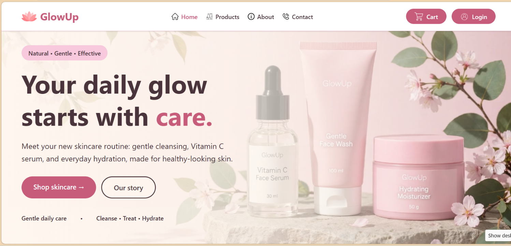
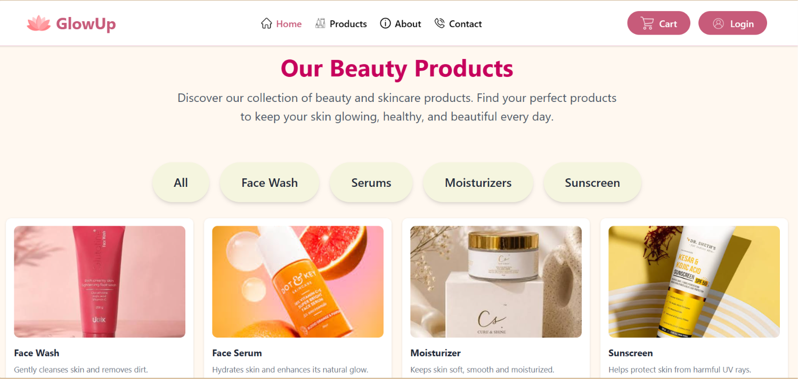
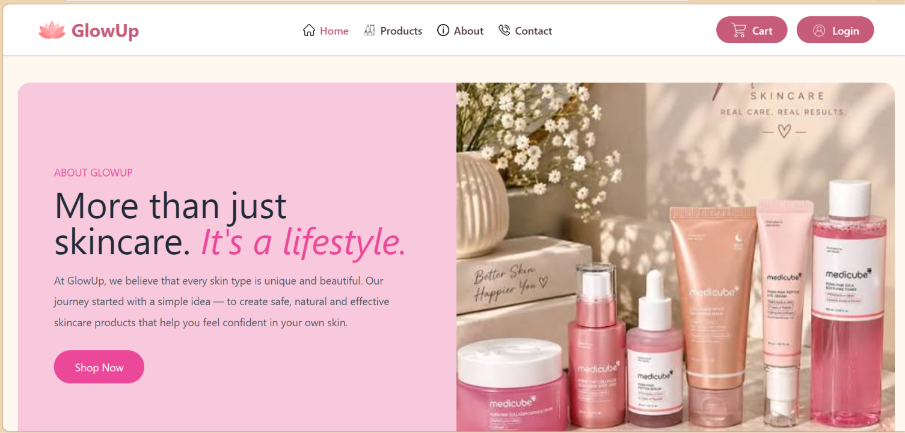

  
  <h1>GlowUp - Beauty and Skincare</h1>

GlowUp is a responsive, multi-page beauty and skincare website built with HTML and Tailwind CSS. Visitors can browse skincare products, learn about the brand, and find contact and account information.

[Live Website](https://glowup-beauty-skincare.vercel.app/)

---

## Features

- Home page with featured skincare products and customer reviews
- Product catalogue with individual pages for skincare items
- About page with the brand story, team, and media
- Cart page layout
- Contact and login pages
- Responsive layouts styled with Tailwind CSS
- Local image, audio, and video assets

---

## Screenshots

### Home Page

### Products Page

### About Page

---

## Tech Stack

- HTML5
- Tailwind CSS via CDN

---

## How to Run

1. Clone or download this repository.
2. Open `index.html` in a web browser.

No build step is required. Tailwind CSS is loaded from a CDN, so an internet connection is needed for the styles to load.

---

## Contributors

---

⭐ If you like this project, give it a star!
